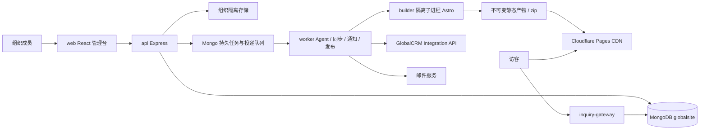

# GlobalSite MVP 技术设计（S1）
版本：2026-11-04；状态：开发设计，尚未实现。GlobalSite 为可独立销售的英文 B2B 建站与运营产品，CRM 连接完全可选。本任务仅初始化文档，不安装应用、不创建业务代码、不迁移数据库。

## 1. 边界、架构与部署
GlobalSite 独立账号、组织、Cookie、密钥、存储与 MongoDB 数据库 `globalsite`。CRM 数据库不得出现在配置、网络连接或查询中；GlobalCRM 不引用本站代码。跨仓复用只复制并在文件头标明源路径、源 commit、改造点与许可依据，不 import、不 npm link。
栈：Node >=20.19、Express 4、TypeScript、Mongoose 8、zod；React 18、Vite、Tailwind、react-router-dom 6、react-hook-form；node:test + tsx。具体锁版本在 S2 验证 Node 兼容性后固定，不因本设计升级 CRM。

| 模块 | 责任 | 进程安排 |
|---|---|---|
| web | 组织管理、产品、事实、可视区块编辑、审核、询盘 | 开发 Vite；生产静态资源，和 API 同域反向代理 |
| api | 登录/RBAC、租户上下文、CRUD、提交任务、审核与审计 | HTTP 进程，不执行构建或等待 AI |
| worker | Agent、旧站读取、导入、CRM 拉取、邮件、发布与补偿 | 开发可同 API 显式启用；生产独立进程，防重复调度 |
| builder | 可信模板 + JSON 快照生成 HTML、资源与 zip | 必须隔离子进程/容器，CPU/内存/时间/网络受限 |
| inquiry-gateway | 公开表单校验、防垃圾、持久接收 | MVP 可与 API 同进程且独立路由/限流；扩展时独立 HTTP 服务 |

单机建议 4 vCPU/8 GiB 起测：反向代理 + api + worker + builder 子进程 + Mongo 副本集（单节点也启用事务）+ 本地持久卷；构建并发 1，AI 并发 2，禁止 builder 拿数据库/CRM/Cloudflare 密钥。不能承诺该配置的生产容量。
扩展：API/gateway 无状态多副本；Mongo 副本集；对象存储；按组织公平调度多 worker；共享限流（Redis 可选）；构建容器池。MVP Mongo 原子租约足够，无 Redis 时单机共享计数存 Mongo；不得用单进程内存计数假装多副本全局限流。
备份：每日 globalsite + 对象清单备份，7 天日备/4 周周备，季度恢复演练。优雅停机释放/等待租约；健康接口区分存活与 Mongo 就绪，AI/CRM/Pages 缺失不影响基本就绪。

## 2. 复制改造来源
只读参考仓库 GlobalCRM，基线取实施时实际 commit，写入每个复制文件；S1 观察基线见 CRM 对接设计。保留版权与许可声明，在 S2 逐项记录依赖和测试；业务代码一律在本站独立维护。

| CRM 来源（相对仓库根） | 本站改造与精简 |
|---|---|
| server/src/models/tenant.plugin.ts、tenant-context.ts、tenant-setup.ts | organizationId 强制上下文；删 Project 推导与缺租户放行；后台只跨租户领取任务，处理时回到指定组织；覆盖 aggregate/bulkWrite/upsert |
| server/src/middleware/auth.middleware.ts；services/auth.service.ts、auth-mail.service.ts；models/User.ts、AuthSession.ts | 独立 Cookie 会话/刷新轮换/撤销、邮箱验证、忘密、邮箱两步验证；删 CRM 项目/菜单权限，映射 Membership 三角色 |
| server/src/services/audit.service.ts；models/AuditLog.ts | 记录事实确认/审核/发布/凭证操作，删客户营销事件；不存正文或密钥 |
| server/src/services/usage.service.ts；constants/plans.ts；models/Organization.ts、UsageRecord.ts | 改站点数、页面、AI、构建、存储、询盘指标；删月营销邮件/CRM 项目额度 |
| server/src/services/storage.service.ts | 独立根前缀与额度；图片/Excel/证书白名单，去掉 CRM 附件访问约定 |
| server/src/worker.ts；background/runtime.ts | 保留启动/停止与租户上下文；删除邮件收箱、获客、营销跟进调度；新增本站持久任务与租约 |
| server/src/services/credential-crypto.ts | AES-GCM 封装、keyVersion/轮换；独立主密钥，不能复用 CRM 主密钥 |
| server/src/services/error-monitor.service.ts、metrics.service.ts；middleware/request-id.middleware.ts | 独立服务名；脱敏与低基数标签，删 CRM 指标 |
| server/src/services/website/public-web.ts | 保留 SSRF/DNS/重定向/大小/超时校验；只读公开网站，文本为不可信候选，不执行嵌入脚本 |
| server/src/models/AgentAiProvider.ts、AgentAiSettings.ts；services/agent/openai-provider.ts | 组织级服务商/加密密钥、结构化响应、预算；删 CRM Agent tools 与默认组织旁路；无提供商时允许人工编辑 |

复制模块对应测试：租户越权/无上下文拒绝、Cookie/刷新重放/忘密与两步验证、审计脱敏、额度并发、路径遍历、任务租约、加解密篡改、SSRF、AI 超时与未配置降级。认证邮箱为全局唯一身份例外；所有组织业务模型使用 tenant 插件。

## 3. 数据模型、索引与关系
约定：ObjectId 以字符串出 API；时间 UTC ISO；所有模型有 _id/createdAt/updatedAt；所有组织业务对象有 organizationId，索引均以前缀 organizationId（表中记 O）隔离。引用必须校验同组织；客户端提供的 O 不可信。U 表示唯一索引；TTL 只作清理，授权仍检查 expiresAt。可变实体 revision 使用 CAS 乐观锁；软删有 deletedAt。状态改变与事件/投递写入事务。

| 模型 | 主要字段（类型/必选语义） | 索引与关系 |
|---|---|---|
| User | emailNormalized:string、passwordHash:secret、emailVerifiedAt:date?、locale:zh/en、status:active/locked、twoFactorEnabled:bool、authVersion:int、verification/reset/challenge 的 tokenHash+expiresAt+attempts | U(emailNormalized)；全局身份用受限 identity 模式接入插件，不携带组织内容；禁止业务层借此绕过租户 |
| Organization | name、slug、plan:trial/starter/growth、limits:object、status、periodStart/End、trialEndsAt、billingEmail?、locale、ownerUserId | U(slug)；组织根受限 root 模式，访问须 Membership；独立数据库 |
| Membership | O、userId?、invitedEmail?、role:admin/editor/viewer、status:invited/active/revoked、inviteTokenHash?、inviteExpiresAt?、invitedBy | U(O,userId) partial；U(O,invitedEmail) partial；用户可属于多组织，邀请码 7 天单次有效 |
| Session | O、userId、familyId、refreshHash、previousRefreshHash?、expiresAt、revokedAt?、lastSeenAt、ipHash、userAgentHash | U(refreshHash)；(userId,familyId)；TTL(expiresAt)；切组织签发新会话并复核成员资格 |
| AuditLog | O、actorId?、action、targetType/id、requestId、redactedDiff、ipHash、expiresAt | (O,createdAt desc)、(O,targetType,targetId)；追加不可编辑，默认保留 180 天 |
| UsageRecord | O、period、metric、operationId、reserved:int、consumed:int、state:reserved/settled/released、expiresAt? | U(O,metric,operationId)；(O,period,metric)；预留/结算/释放一次，过期预留由补偿任务核对 |
| Product | O、sku、name、category、description、specs:[code/name/value/unit]、moq?、leadTime?、assetIds、source:local/crm、crmConnectionId?、remoteId?、remoteUpdatedAt?、remoteRevision?、syncCandidate?、localOverrides、revision、status:active/archived | U(O,sku)；U(O,crmConnectionId,remoteId) partial；(O,category,status)；硬数据另引用 FactSheet |
| Asset | O、storageKey、sha256、mime、bytes、kind:image/document/import/export、scanStatus:pending/clean/rejected、visibility:private/published、width/height?、sourceRef?、expiresAt? | U(O,storageKey)；(O,sha256)；(O,expiresAt)；只允许 clean 资源进入审核版本 |
| FactSheet | O、subjectType:organization/product、subjectId、key、value:string/number、unit?、source:{kind,ref,quoteHash,capturedAt}、status:candidate/confirmed/rejected/expired、confirmedBy/At?、validFrom/Until?、revision | (O,subjectType,subjectId,key,status)；(O,status,updatedAt)；每条记录一个事实；修订保留审计并重新确认 |
| Site | O、name、slug、industry、templateId、templateVersion、locale:en、status、draftRevision、currentVersionId?、currentDeploymentId?、gatewayPublicId、canonicalBaseUrl?、domains:[host,status,verifiedAt,httpsAt]、publishLock | U(O,slug)；U(gatewayPublicId)受控公开解析；U(domains.host) partial 防域名争抢；公开 ID 仅定位组织 |
| SitePage | O、siteId、path、type、title、seo:{description,canonical?}、keywordCluster、status:draft/blocked/approved、revision、factRefs:[id,revision] | U(O,siteId,path)；(O,siteId,status)；路径规范化，禁 ../ 和保留路径 |
| SiteBlock | O、siteId、pageId、type、order:int、schemaVersion、props:validated JSON、factRefs、revision | U(O,pageId,order)；(O,siteId,pageId)；白名单区块与受控富文本，不接受代码/任意脚本 |
| SiteVersion | O、siteId、number、snapshotKey、snapshotHash、templateVersion、factRevisions、review:{status,reviewer,reviewedAt,snapshotHash}、artifactKey?、artifactHash?、status、createdBy | U(O,siteId,number)；U(O,siteId,snapshotHash)；不可变快照，审核后内容变更创建新版本 |
| SiteDeployment | O、siteId、versionId、target:preview/production/export、provider:local/cloudflare、providerDeploymentId?、url?、status:queued/building/uploading/verifying/live/failed/unknown、operationId、previousDeploymentId?、errorCode? | U(O,operationId)；(O,siteId,createdAt desc)；只在远端和 HTTPS 核验后切 currentDeploymentId |
| SiteInquiry | O、siteId、submissionId、dedupeHash、contact:{name,email,company?,country?,phone?}、message、productIds、quantity?、pageUrl、utm、consent:{version,at}、attachmentIds、spamStatus、status:new/assigned/contacted/closed、assigneeId?、crmCustomerId?、crmInquiryId?、crmOutcome?、deliveriesEnqueuedAt? | U(O,siteId,submissionId)；(O,siteId,createdAt desc)、(O,dedupeHash,createdAt)；资料加密存储、后台脱敏授权，默认 365 天保留 |
| AgentRun | O、siteId?、kind、inputSnapshotKey/hash、step、status:queued/running/waiting_review/succeeded/failed/cancelled、outputs、stepAttempts、leaseOwner/until、fencingToken、budgetReserved、actualTokens、idempotencyKey、errorCode | U(O,idempotencyKey)；(status,leaseUntil)仅调度受控跨租户；(O,siteId,createdAt) |
| CrmConnection | O、name、baseUrl、projectId、credentialCiphertext/iv/tag/keyVersion、credentialFingerprint、scopes、capabilities、status:disconnected/checking/connected/degraded/revoked、lastCheckedAt | U(O,baseUrl,projectId)；仅 admin 写，凭证不出响应；1 连接固定 1 CRM 项目 |
| CrmSyncState | O、connectionId、resource、cursor?、lastSuccessAt、status、leaseUntil/owner、fencingToken、snapshotUpperBound?、lastErrorCode? | U(O,connectionId,resource)；(O,status)；游标按资源独立，处理后提交 |
| OutboundDelivery | O、inquiryId?、connectionId?、kind:crm/email、payloadEncrypted、payloadHash、idempotencyKey、status:pending/sending/sent/retry/dead/paused、attempts、nextAttemptAt、leaseUntil/owner、fencingToken、remoteId?、lastErrorCode/requestId? | U(O,kind,idempotencyKey)；(status,nextAttemptAt,leaseUntil)受控调度；(O,inquiryId)；邮件/CRM 分别投递 |

User/Organization 的 identity/root 模式仅支持认证与组织选择，在 S2 以测试锁定允许字段/操作；Session 与 Membership 为组织业务模型不可跳过插件。新增组织业务模型同样接入插件，不能因表中未列而免除。
一致性：单 Mongo 文档接收询盘写 majority 成功后返回；事务生成邮件与 CRM OutboundDelivery，若进程在两步间退出，由扫描 deliveriesEnqueuedAt 为空的询盘补建（唯一索引保证一次）。不要求访客等待第三方。
迁移：S1 无迁移；S2 创建 globalsite 初始集合/索引及可重入 migration 账本；先处理重复再建唯一索引。后续按阶段添加字段/回填/建索引，不触碰 CRM 库名或集合。CRM 新模型/索引由 C 阶段单独迁移与验证。

## 4. Agent 编排与人工节点
| 步骤 | 输入 | 输出/关卡 |
|---|---|---|
| 导入与旧站采集 | Excel 映射/图片/公开 URL | 产品草稿、候选事实与来源；用户处理重复 SKU/解析失败 |
| 事实整理 | 候选/CRM 公共资料/证书 | 逐条确认事实；未确认数据不能用于硬声明 |
| 研究 | 已确认企业与产品、目标市场 | 关键词、采购意图、聚类、证据 URL/采集时间；无外部研究服务时允许人工输入并标注 |
| 站点规划 | 聚类、行业模板、产品范围 | sitemap：首页/分类/详情/关于/工厂质量/认证/FAQ/联系；人工确认结构与目标词 |
| 内容生成 | 审核后的规划 + 指定事实版本 | 页面/区块 JSON、每个硬声明引用；只生成英文，UI 中英双语 |
| 事实/安全/SEO 校验 | JSON、事实快照、区块 schema | 引用/数值/单位/有效期检查、脚本/链接/SEO/可访问性报告；问题阻断 |
| 人工审核 | 桌面/移动预览、来源、差异与报告 | admin 审核 snapshotHash；编辑后审核失效 |
| 构建/发布 | 已审核不可变版本 | HTML/zip/预览；admin 单独确认发布，失败保留当前线上版本 |

任务入队即冻结输入摘要与步骤版本；每步保存输出，不以页面刷新重复生成。原子领取 60 秒租约、20 秒续租、递增 fencingToken，旧持有者失去写入权；同站生成/发布互斥，支持取消与过期回收。外部 AI 超时 90 秒，瞬态错误最多 3 次（抖动退避 5/20/60 秒）；无效结构最多修复 1 次，事实缺失直接等待人工。重试可能产生供应商费用，分别计量；拒绝把失败重试无限扣费。
AI 调用前原子预留 token 上限与成本预算，用模型返回 usage 结算，未发生调用释放；超时未知用量保守预留并对账。总预算不足暂停新调用，已生成内容可手工完成。提示词、检索文本、旧站文字为数据，不能覆盖工具权限；只读研究工具，不给 Agent 发布权、凭证或任意网络工具。

## 5. 静态构建与模板
推荐 Astro static output：可信模板代码 + 版本快照 JSON，动态路由一次生成全站，少量表单交互用受控脚本；管理台继续 React/Vite。Astro 的[静态输出配置](https://docs.astro.build/en/reference/configuration-reference/)与[构建命令](https://docs.astro.build/en/reference/cli-reference/)支持此方式；不在访客请求时读数据库。
备选：Eleventy（更轻、模板简单，复杂区块组件需自行规范）；Next.js static export（React 复用方便，但动态功能需严格约束，MVP 引入成本较高）。选择 Astro 是设计建议，S4 做同一 100 页夹具基准后锁版本。
构建步骤：校验审核 hash/事实有效期 → 复制模板到临时目录 → 写只含公开内容的 JSON → 生成 HTML/robots/sitemap/llms/JSON-LD → 链接和资源扫描 → 压缩/产物 hash → 原子归档。依赖安装在发布镜像阶段完成，单次构建不运行 npm install，不执行用户代码。
性能预算（非实测）：4 vCPU/8GiB、已缓存依赖，50 页 10–30 秒、200 页 30–90 秒、1000 页 2–5 分钟；冷启动/图片另计，超 10 分钟中止。S4 记录 p50/p95、峰值内存、产物体积再调上限。构建并发默认 1，每次 2GiB、临时空间 2GiB；不访问公网，仅读取已清洗资源。

三套模板：机械设备（规格、应用、工厂能力、询价）；建材五金（材料/尺寸/表面处理/认证）；包装与箱包（材质/工艺/定制/起订量）。共享 header/hero/category-grid/product-specs/process/quality/certificates/FAQ/contact/footer 区块 schema；只展示有事实依据的硬数据。模板支持 360/768/1440 宽度、键盘、对比度、图片 alt，产品图不存在时使用中性占位不伪造证书。
SEO/GEO：静态 title/meta/canonical，唯一正式主域，迁移主域重新构建；sitemap 仅正式可索引 URL；Organization/Product/FAQPage/BreadcrumbList 只输出页面可见且已确认信息，价格无确认不输出 Offer。llms.txt 提供公开页面摘要和链接，为实验性辅助文件，不保证被引用或收录。
正式 robots 放行 GPTBot、OAI-SearchBot、PerplexityBot、Google-Extended 与公共页面；预览统一 noindex/nofollow + X-Robots-Tag，robots 禁抓并加访问控制（noindex 不保护隐私）。Google-Extended 是用途控制 token，不是单独爬虫；允许抓取不等于保证 GEO 效果。不得将询盘/后台/来源私密附件放入构建产物。

## 6. 发布、域名与降级
Cloudflare Direct Upload：worker 构建后上传散列资源与 manifest，通过 API 建立/查询 Pages 项目和 deployment；使用官方上传流程的 upload-token、check-missing、upload、upsert-hashes 等资产步骤，按实际缺失资源上传，最后提交 multipart manifest。S5 根据官方 API 做沙箱验证，不假设“一个 zip POST”即可完成 API 发布；zip 是用户导出格式。
API 路径族：/accounts/{account}/pages/projects，/{project}/deployments，/{project}/domains，以及 deployment 查询/rollback。MVP 一站一 Pages 项目，记录远端 ID 与本地 versionId；API 无统一业务幂等承诺，超时进入 unknown、按 deployment metadata 查询对账，不能盲目重复发布。
域名：先创建域名关联并生成所有权验证要求 → 用户配置 DNS → 检测权威 DNS 与 Pages 状态 → 检查 HTTPS 证书 SAN/有效期/正式 URL → 标记 active。主域可能需转 Cloudflare DNS；子域按官方 CNAME 指引。不得自动改用户 DNS；domain ownership 与组织唯一绑定，移除后清理 CORS 允许列表，防悬挂域名。
Token：最小 Pages 编辑权限、限定账户；若自动 DNS 后续另授权 zone 权限，MVP 手工 DNS 不索要它。按组织 AES-256-GCM 加密，独立主密钥、IV/tag/keyVersion，密钥放服务端 secret 配置，审计只记指纹；轮换后先验证再切换。旧产物保留 10 个正式版本，预览 7 天；回滚优先远端 rollback 到成功版本，不可用则重部署历史不可变产物，仍需核验事实过期及安全整改，不能回滚已撤销凭证或租户权限。
未配置 Pages/Token：保留本地受控预览与 zip 导出，发布按钮说明配置要求，API/worker 正常启动。AI 未配置允许人工建站；邮件未配置保存通知待办并显示提醒；CRM 未连接不入 CRM 投递队列；对象存储未配置单机本地存储。主加密密钥缺失禁止保存新凭证，不生成伪密钥，不阻断无外部连接的功能。
未来配置在 S2/S5 写入本站 .env.example 与 production.env.example（S1 禁止新增这两个文件）：GLOBALSITE_MONGODB_URI 指向 globalsite、GLOBALSITE_PUBLIC_URL、GLOBALSITE_GATEWAY_URL、GLOBALSITE_CREDENTIAL_KEY、GLOBALSITE_STORAGE_ROOT，以及可选 SMTP、AI、Cloudflare、Turnstile 设置；具体名字届时冻结，CRM 现有环境变量不改。
参考：[Direct Upload](https://developers.cloudflare.com/pages/get-started/direct-upload/)、[Pages API](https://developers.cloudflare.com/api/resources/pages/)、[自定义域名](https://developers.cloudflare.com/pages/configuration/custom-domains/)、[平台限制](https://developers.cloudflare.com/pages/platform/limits/)。实施时重新检查供应商限制，不将免费套餐容量写死。

## 7. 询盘安全、通知与可靠投递
公开 POST /public/v1/sites/{publicId}/inquiries：Origin 精确允许已验证正式域名/受控预览域名，禁止通配凭证 CORS；无 Cookie、不携带组织 ID、不接受客户端指定 CRM 项目。CORS 不能阻挡非浏览器，必须叠加限流/蜜罐/验证码。无 Origin 的跨域 JSON 请求默认拒绝；后续服务端接入需要单独签名协议。
建议初始限制：IP+站点每分钟 5 次/每小时 30 次，站点每分钟 100 次，全局保护阈值；可信代理限定跳数，不信任任意 X-Forwarded-For。蜜罐非空/提交过快进入隔离，不推送 CRM、不发邮件；前端对可疑询盘返回统一受理提示，避免探测。
JSON 最大 32KiB；name 120、email 200、company 200、phone 60、country 120、message 5000、产品最多 20、URL 2048；zod 严格白名单、去 HTML/控制字符、禁止邮件头注入。表单必须展示隐私说明及版本化同意字段。
Turnstile 可选，配置时服务端 Siteverify 校验 success、hostname/action，token 5 分钟单次有效；失败拒绝、不以客户端结果为凭。未配置降级为更严限流/蜜罐/隔离，后台显著提示，服务仍启动；验证服务故障隔离存档而不无条件投 CRM。[验证规则](https://developers.cloudflare.com/turnstile/get-started/server-side-validation/)。
公开附件默认关闭；启用时独立预上传：最多 3 个、单个 5MiB、总计 10MiB，限定 JPEG/PNG/PDF，魔数验证、杀毒、隔离桶/随机名、禁 SVG/HTML/可执行与压缩包、不可公开链接；未扫描完成不进入通知。管理上传产品图单个 10MiB，Excel 10MiB/5000 行并限制解压体积，防压缩炸弹。
去重：客户端每次表单生成 submissionId（UUID），网络重试复用；U(O,site,submissionId) 返回首次 receipt，同 ID 不同正文 409。正文/规范邮箱/产品摘要 HMAC 10 分钟候选重复只标记供人工确认，不仅凭同邮箱丢弃真实新需求。
通过校验先持久化询盘，返回 202 receiptId/status:received；Mongo 写失败返回 503，不能假受理。通知与 CRM 分别 OutboundDelivery，email 用稳定 Message-ID 但不宣称收件端 exactly-once；默认发提醒和后台链接，不附完整敏感内容。
CRM 推送、幂等与字段以权威 CRM 契约为准（下一节），本站只保存投递状态：超时/429/5xx 抖动退避（30s、2m、10m、30m、2h、6h、12h、24h，最多 8 次），遵守 Retry-After；401/403 暂停连接；校验/冲突进入 dead，人工修正另建业务修订键。lease+fencing 防双 worker；后台可见最后错误码/requestId、重试时间；人工重试复用原始 payload/key。断连后先暂停在途任务，重连同项目核对后继续；更换项目必须新连接，不把旧询盘自动改投另一项目。

## 8. GlobalCRM 连接边界与唯一契约
唯一对接依据：
- [GlobalCRM OpenAPI（S1 固定草案提交）](https://github.com/D77-jpg/GlobalCRM/blob/9930762be20908ec50513a2f2b723e1dcdd93ca1/docs/integration/integration-v1.openapi.yaml)
- [GlobalCRM 对接设计](https://github.com/D77-jpg/GlobalCRM/blob/9930762be20908ec50513a2f2b723e1dcdd93ca1/docs/integration/globalsite-%E5%AF%B9%E6%8E%A5%E8%AE%BE%E8%AE%A1.md)

当前链接固定到 CRM S1 草案提交 9930762，避免分支继续变更造成漂移；实现时经双方批准后更新到正式冻结 commit。本站不复制或另建 Integration API 定义。具体端点/scope、CRM DTO 字段映射、游标、错误码及 C1–C4 草案均只在上述两文件维护。本站私有 API 见 §10，不代表 CRM 契约。
连接流程：管理员输入 CRM HTTPS 基址/项目/服务凭证 → 后端 SSRF 校验并调用已契约化健康检查 → 显示 scope 与连接能力 → 选择同步范围 → 拉取候选 → 人工确认。服务器禁止内网/环回/元数据/非 HTTPS 以及跨源重定向；本地开发只通过显式白名单模拟服务。
同步：CRM 为来源，本地独立存储；remoteId 识别，CRM 修改进入候选差异，不覆盖本地人工覆盖字段或已确认事实；删除/归档隐藏新建页面入口，已发布版本提示审核后重新发布。产品/资料分页落盘后更新 CrmSyncState，定时 15 分钟、手工触发限流；成交事件 5 分钟轮询，按 eventId 去重，只关联已知 customerId；空页不清空已有游标。
已知差异 GS-D01：现有客户状态/客户报价查询有未契约化的来源选项；经任务用户确认，本次登记并保持现状，GlobalSite MVP 不调用这两个接口。不得自行根据实现补猜调用规则。其他已有接口仍保持原行为。草案能力未实现时 UI 显示“尚不支持”，不把 404 猜作空数据。
未连接：Excel/本地资料/建站/发布/询盘/通知全部可用；不强制 CRM 注册。连接前询盘默认不补推，管理员可选择时间段并确认隐私授权再生成投递。

## 9. 套餐与计量建议
下表为建议产品限制，不是售价或供应商承诺；按组织计，月度 UTC 周期，免费试用 14 天，不接真实支付作为 MVP 前置。
| 指标 | trial | starter | growth | 计量 |
|---|---:|---:|---:|---|
| 成员/站点 | 2/1 | 3/1 | 10/5 | 活跃对象（停用释放，不删数据） |
| 产品/每站页面 | 50/50 | 500/200 | 5000/1000 | 活跃产品/版本页数 |
| 月 AI tokens | 200000 | 2000000 | 10000000 | 输入+输出，预留后结算 |
| 月构建次数 | 20 | 100 | 500 | 真正启动计一次，系统基础设施失败返还 |
| 存储 | 1GiB | 10GiB | 50GiB | 原图/产物/附件总字节，去重不跨组织 |
| 月通知邮件 | 100 | 1000 | 10000 | 邮件成功提交一次，重试不重复计 |
| 月询盘软阈值 | 100 | 1000 | 10000 | 先存档；超额告警，不丢询盘 |
| 构建/AI 并发 | 1/1 | 1/2 | 2/4 | 组织与全局两级预算 |

超额：停止新 AI/构建/大文件上传，保留在线站、询盘接收与导出；硬磁盘配额临界时全局报警/503 明确失败，不能无限接收。计费金额以后再决策；usage 并发预留事务与幂等 operationId 防超售。管理台显示周期/使用/预留/上限。

## 10. GlobalSite API 清单（设计，待 S2–S7 实现）
前缀 /api/v1；权限 P=公开，V=已登录验证邮箱，R=组织只读以上，E=编辑以上，A=组织管理员。邀请/验证/重置为短期单次 token；写 API 用 CSRF + Origin 校验，任务型写入带 Idempotency-Key、更新带 revision（不一致 409）。
统一成功 {success:true,data:...}，错误 {success:false,error:{code,message,requestId,details?}}；集合 data={items,nextCursor,hasMore} limit 默认 50/最大 200，ID 引用同组织；异步 202 {operationId,status}。不在此定义 CRM DTO。
| 方法 路径 | 权限 | 请求 → data / 状态 |
|---|---|---|
| POST /auth/register | P | email/password/name/locale → userId,verificationRequired；201 |
| POST /auth/verify-email；/auth/resend-verification | P | token 或 email → verified 或 accepted；200/202，不泄露邮箱存在性 |
| POST /auth/login | P | email/password → authenticated 或 challengeId；200，成功写 HttpOnly Cookie |
| POST /auth/2fa/verify | P | challengeId/code → authenticated；200，限次、有效 5 分钟 |
| POST /auth/refresh；/auth/logout | Cookie | CSRF → authenticated 或 loggedOut；200，刷新轮换、退出撤销 |
| POST /auth/forgot-password；/auth/reset-password | P | email 或 token/password → accepted 或 reset；202/200 |
| GET /auth/me；PATCH /auth/me | V | 无 或 locale/name → user/profile |
| POST /auth/2fa/enable；/auth/2fa/disable | V | password+邮箱 code → enabled；200，二次验证 |
| POST /organizations；GET /organizations | V | name/slug 或 无 → organization 或 items；201/200 |
| POST /organizations/{id}/select | V | 无 → sessionOrganization；200，成员资格检查 |
| GET/PATCH /organization | R/A | 无 或 name/locale → organization |
| GET /members；POST /invitations；PATCH /members/{id} | R/A/A | 无；email/role；role/status → members/invitation/member |
| POST /invitations/accept | V | token → membership；200，校验邮箱 |
| GET /usage；GET /plans | R | 无 → metrics/limits 或 plans；200 |
| GET/POST /products；GET/PATCH /products/{id} | R/E | 查询；产品字段；revision+patch → list/product；200/201 |
| POST /products/imports；GET /products/imports/{runId} | E/R | assetId+columnMap → operation；查看映射错误与候选；202/200 |
| POST /products/imports/{runId}/confirm | E | rowChoices → imported/failedCounts；200（只提交确认行） |
| POST /assets；GET /assets/{id}/download；DELETE /assets/{id} | E/R/E | multipart 或 无 → asset/短期 URL/deleted；201/200 |
| GET/POST /facts；PATCH /facts/{id} | R/E | 筛选；事实及来源；revision+patch → list/fact；200/201 |
| POST /facts/{id}/confirm；/facts/{id}/reject | A | revision/reason → fact；200，记录确认者 |
| POST /website-reads | E | publicUrl → operation；202，候选无自动确认 |
| GET/POST /sites；GET/PATCH /sites/{id} | R/E | 筛选；name/industry/templateId；revision+patch → list/site |
| GET /templates | R | industry? → templates+blockSchemas；200 |
| GET/POST /sites/{id}/pages；PATCH /pages/{id} | R/E | 页面字段/revision → pages/page；200/201 |
| PUT /pages/{id}/blocks | E | revision+有序白名单 blocks → blocks+revision；200，整页 CAS |
| POST /sites/{id}/agent-runs；GET /agent-runs/{id}；POST /agent-runs/{id}/cancel | E/R/E | kind/input/idempotency → operation/run/cancelled；202/200 |
| POST /agent-runs/{id}/confirm | A | step/outputHash/decisions → run；200，审核规划 |
| POST /sites/{id}/versions；GET /sites/{id}/versions | E/R | draftRevision → version；201/200，不可变 |
| POST /versions/{id}/approve；/reject | A | snapshotHash/reason → review；200，拒绝不发布 |
| POST /versions/{id}/build；/preview；/export | E | 无 → operation；202；preview 必须受控，export 短期下载 |
| GET /operations/{id} | R | 无 → status/result/errorCode；200，任务需同组织 |
| POST /sites/{id}/deployments；POST /sites/{id}/rollback | A | approvedVersionId 或 deploymentId → operation；202 |
| GET /sites/{id}/deployments | R | cursor → deployments；200 |
| PUT /sites/{id}/publishing | A | accountId/projectName/token? → configured+指纹；200，token 永不返回 |
| POST /sites/{id}/domains；POST /sites/{id}/domains/check；DELETE /sites/{id}/domains/{host} | A | host/无 → domain 或 operation；201/202/200 |
| GET /inquiries；GET/PATCH /inquiries/{id} | R/E | 筛选；status/assignee/revision → list/inquiry；200，viewer 默认脱敏 |
| POST /inquiries/exports | A | filters/dateRange → operation；202，CSV 防公式注入 |
| POST /inquiries/{id}/deliveries/{deliveryId}/retry | A | 无 → delivery；202，复用原键、原载荷 |
| POST /crm-connections；PATCH /crm-connections/{id} | A | baseUrl/projectId/token 或 rotateToken → connection（脱敏）；201/200 |
| POST /crm-connections/{id}/check；/sync；/disconnect | A | 无 或 resources → operation/state；202/200 |
| GET /crm-connections；GET /crm-connections/{id}/sync-state | A | 无 → connections/state；200 |
| POST /crm-connections/{id}/backfill | A | range+confirmedConsent → operation；202，默认关闭历史补推 |
| GET /audit-logs | A | cursor/action/dateRange → list；200 |
| GET /health/live；/health/ready | P/运维 | 无 → ok（不泄露配置）；200 或 ready 503 |

公开 gateway 独立前缀 /public/v1/sites/{publicId}：POST /inquiries（请求字段见 §7 → 202 {receiptId,status:received}），可选 POST /attachments（multipart + Turnstile → 201 {attachmentToken,expiresAt}）。无公开按邮箱查询/列表接口；公共错误限制细节，限流 429 带 Retry-After。S2–S7 逐步将本站 API 写入本站 OpenAPI 并测试，本次只列设计清单。

## 11. 前端页面与交互
登录/注册/验证邮箱/忘记重置/两步验证；组织选择与创建；工作台引导；成员邀请/角色；套餐与用量；产品列表/Excel 映射与行错误/产品编辑；媒体库；事实列表/来源对照/逐条确认；旧站读取候选；站点列表/创建向导；研究与聚类/站点地图确认；模板选择；区块编辑与事实引用侧栏；Agent 进度/费用/重试；桌面移动预览；审核差异/阻断项；版本/发布/回滚；域名检查；询盘列表/详情/分派/投递状态/导出；CRM 连接/范围选择/同步冲突；审计。
主流程：注册→验证→创建组织→导入产品与资料→确认事实→选模板→研究/确认结构→生成→修复阻断项→人工审核→预览/发布→收询盘→后台处理/通知→可选 CRM 交接及成交回流。任一步可保存退出；未配置 AI/CRM/Pages 显示对应可用替代路径。
admin 管理组织/角色/凭证/事实确认/最终审核/发布/导出；editor 编辑/导入/生成/提交审核；viewer 浏览（敏感信息脱敏，不能导出）。服务器强制权限，隐藏按钮只辅助体验。前端一切可见字符串/校验/错误映射均 zh/en i18n；英文站内容与管理台语言独立。表单 react-hook-form，行错误可定位，长任务不锁死页面。

## 12. 安全与合规
防编造：数字/价格/产能/交期/认证/客户名称等均须 confirmed 且未过期 FactSheet id+revision；Agent 不得把 CRM 导入、旧站内容当已确认。缺证据隐藏字段或阻断，禁止虚构背书；引用撤回后冻结新发布，线上版本提示下架/修订；审核 hash 与版本绑定。
数据隔离：tenant 插件 fail-closed，关联外键同租户；gateway 从公开站点解析组织，文件按组织签名访问；会话同组织校验、角色撤销即失效。Cookie HttpOnly/Secure/SameSite，刷新 token 只存 hash，CSRF/Origin 双校验，登录/验证/重置限次、统一回复，密码修改撤销其他会话；MVP 两步验证采用邮箱 OTP，TOTP/恢复码后续评估。
加密：TLS、备份和磁盘加密；CRM/AI/Pages token AES-GCM，询盘联系资料按字段加密（查重用 keyed HMAC），日志不可打印 token、邮箱、正文、提示词私密数据；生产关闭敏感调试。导入文件防公式执行，CSV 导出以 =/+/-/@ 开头字段转义。
Cookie 同意：MVP 不默认嵌第三方分析，必要会话与安全 Cookie 分类说明；可选分析在获同意后加载，拒绝和撤回同样容易，记录版本不关联跨站画像。静态站如只用询盘无会话，不人为设置追踪 Cookie。
隐私政策模板字段：运营主体/联系方式、收集字段与用途（回应询盘）、处理依据、处理者（邮件/托管/可选 CRM/AI）、跨境位置、保留期、访问/更正/删除请求方式、必要 Cookie 与可选同意、最后更新时间。注册者填全并审核后才能发布；未决定地区时不宣称符合某项法规，正式上线前按销售地区审阅模板。默认不将访客完整询盘送 AI；删除请求清理查询、附件、队列并按备份生命周期淘汰。

## 13. 测试计划与门槛
单元：复制模块的安全边界、schema、字段映射（从 CRM 契约夹具引用）、事实引用/单位/有效期、预算预留结算、规范路径、CSV 转义与重试分类。
集成：mongodb-memory-server/测试副本集，注册验证/刷新撤销/邀请 RBAC、租户 CRUD/聚合/后台、导入断点、询盘持久与 outbox 修复、队列租约/双 worker、CRM 超时/凭证撤销/游标/linked、发布 unknown 对账。
契约：CRM 端冻结已有端点定义与行为，C 阶段批准新增草案后才更新冻结快照/CI；本站固定批准契约 commit，校验每个实际请求/响应结构、必选字段/枚举/错误码；负例跨项目/缺 scope/重复键异载荷/未知可选字段。S1 只对文档与新增草案结构静态校验，不伪称端点已实现。
E2E：英文产品站三行业模板、zh/en 管理台、移动与键盘；独立模式整条主流程；可选 CRM 模式询盘/通知/回流；无 AI/SMTP/Pages/CRM 降级；旧版本回滚；构建产物中无私密字段。
发布门槛：GlobalSite npm run typecheck/build/lint、npm test；GlobalCRM 涉及实现时 typecheck/build/lint、server test:security/test:integration/test:health；S1 CRM 同样执行这些现有检查。本站 S1 无 package.json，四条命令明确记为不可运行，不添加伪脚本使其绿灯。静态检查 Markdown 链接、Mermaid、YAML 引用、旧 paths/components 结构不变；固定哈希门禁的已知草案变更单列记录。

## 14. S2–S7 与 C1–C4 开发计划
未收到 S2–S7/C1–C4 原始任务详单；以下是本设计的建议拆分，后续任务编号说明若不同必须先对齐，不能假定已获实施授权。
| 阶段 | GlobalSite 范围/验收 | CRM 依赖 |
|---|---|---|
| S2 | 工程、复制基础模块、globalsite 初始化、多租户/账号/成员/计量、测试底座 | 无，独立运行 |
| S3 | 产品/Excel/图片、事实/来源确认、旧站候选、导入安全与断点 | C1/C2/C3 可并行规划，本站先用契约 mock |
| S4 | 研究与规划、3 模板/区块、内容与事实验证、审核、静态构建基准 | 不依赖 CRM |
| S5 | Worker 构建/zip/受控预览、版本/Pages/域名/HTTPS/回滚 | 不依赖 CRM |
| S6 | gateway 安全/先存档/邮件/后台询盘/CSV、可靠投递 | C4 在接通前完成，未实现保持独立模式 |
| S7 | 可选连接、候选同步/冲突/断线与成交回流、双方契约/E2E/运维与试点 | C1–C4 批准与实现后 J1 联调 |

CRM C1–C4 的端点定义和拆分只维护在 CRM 契约中。调整理由：把独立询盘闭环放在 CRM 联调前，证明产品独立可售；CRM 未就绪不阻断 S2–S6。J1 须明确双方可写范围、独立分支/提交/PR，不能混仓。
每阶段测试与文档一起交付；涉及接口按“CRM 契约→CRM 实现→本站调用”顺序；草案不作为上线能力。

## 15. 风险、待决策与非目标
1. C1–C4 详细任务尚未给出，本设计建议需与后续任务对齐；原有查询契约差异已获同意登记避开，未来单独修复，不夹带本次。
2. 是否接受 Astro 与建议额度/套餐名？S4 用实际页数/构建预算再冻结；当前无实测性能与收费价格。
3. Cloudflare 由每组织自带账户/Token（MVP 推荐）还是平台统一账户？关系到成本/项目数/域名与责任，正式收费前确认；无配置可 zip 导出。
4. SMTP 服务、发件域名与交付地区待确认；没有真实 SMTP 不开放无保护注册试点，开发用测试邮箱，不在文档放凭证。
5. AI 服务商、模型/单次与每月成本、关键词数据来源待确认；无外部关键词服务只给建议，不捏造搜索量。
6. 目标司法地区/数据区域/询盘默认保留 365 天待上线前确认；隐私政策是待填写模板，不能把空模板直接发布。
7. CRM 当前 Product 没有图片关系，资料也没有专门“公开到 GlobalSite”的授权标记；只能在 C2/C3 建立显式发布投影后同步，不能将内部价格、notes 或私密资料直接导出。
8. 访客附件默认关闭；开启前落实杀毒/对象隔离与配额。noindex 不保证不被获取，私密预览必须鉴权。
9. S1 改 OpenAPI 全文件字节会触发现有 SHA 冻结门禁。按任务要求保留快照，C 实现时一并处理；该文档 PR 不宣称所有远端门禁通过。
非目标：CRM 账号共用、共享数据库、营销自动触达、AI 自动发布、任意网站代码执行、支付结算、全语言网站、自动 DNS 修改、CRM 报价改造。

## 16. 文档实施与来源记录
本设计只提出未来数据结构；S1 未新增集合/环境文件/依赖/应用。GlobalCRM root AGENTS.md 当前不存在，因本任务只允许 docs/integration，不能在 CRM 根目录补建；范围规则记录在 CRM 对接设计，后续获准根目录任务再补。
技术外部依据查阅于 2026-11-04，链接见构建/发布/Turnstile 章节；供应商行为以实施时官方文档和沙箱测试为准。本站初始文档不重复持有 CRM OpenAPI。

### 隐私政策与 Cookie 说明模板（发布前填写并审核）
中文模板：本网站由【企业法定名称、地址、联系邮箱】运营。您提交的【姓名、工作邮箱、公司、需求、可选电话及附件】用于回复产品询问与处理采购沟通，不用于自动营销。我们使用【托管/邮件供应商及数据区域】处理这些信息；仅在本企业启用 CRM 对接时转交【CRM 运营主体与区域】。默认保留【期限】后删除或匿名化，法律要求另行保留的情况按适用规则处理。您可向【隐私联系邮箱】请求访问、更正、删除资料或撤回可选同意。本站必要安全功能使用【实际 Cookie 名称、用途、有效期；无则写无】；可选统计【供应商、用途】在您选择同意后启用，并可通过【设置入口】撤回。更新日期【日期】、政策版本【版本】。发布者需补充目标地区要求的处理依据、跨境机制与权利说明。
English template: This website is operated by [legal company name, address and privacy email]. We use the contact details and product requirements you submit to respond to your inquiry and manage procurement communications. Our service providers are [hosting/email providers and processing regions]. If our CRM connection is enabled, inquiry data is also shared with [CRM operator and region] for the same purpose. We retain inquiry data for [period], then delete or anonymize it, subject to applicable retention requirements. Contact [privacy email] to request access, correction or deletion, or to withdraw optional consent. Necessary cookies: [actual names, purposes and duration, or none]. Optional analytics from [provider] loads only after consent; change your choice at [settings link]. Updated: [date]. Version: [version]. The publisher must complete the applicable legal basis, international transfer and local rights disclosures before publication.
表单同意文案（zh/en）：我已阅读隐私政策，并同意贵公司使用所填信息回复本次询盘。/ I have read the Privacy Policy and agree that the company may use the information provided to respond to this inquiry. 不勾选营销授权；需要营销时独立可选同意，不与询盘受理捆绑。

### S1 实际校验记录（2026-11-04）
GlobalSite 的 npm run typecheck、npm run build、npm run lint、npm test 均已尝试，因本任务不创建 package.json 返回 ENOENT，不能记为通过。文档静态检查通过：本地链接、UTF-8、代码围栏、19 个模型与 16 个编号设计章节齐全。无业务代码或数据库迁移。
GlobalCRM npm run typecheck、npm run build、npm run lint 通过（lint 12 条现有 warning）；server test:integration 24/24、test:security 19/19、test:health 5/5 均无跳过。首次受限环境临时 MongoDB 启动失败，正常本机权限重跑通过。YAML 可解析，旧 6 个基础路径/旧组件逐项深等，6 个新增草案操作与 121 个引用校验通过；此静态检查不等同完整 OpenAPI 发布认证。固定 SHA 发布门禁尚未更新，预期无法通过（见 §15）。
